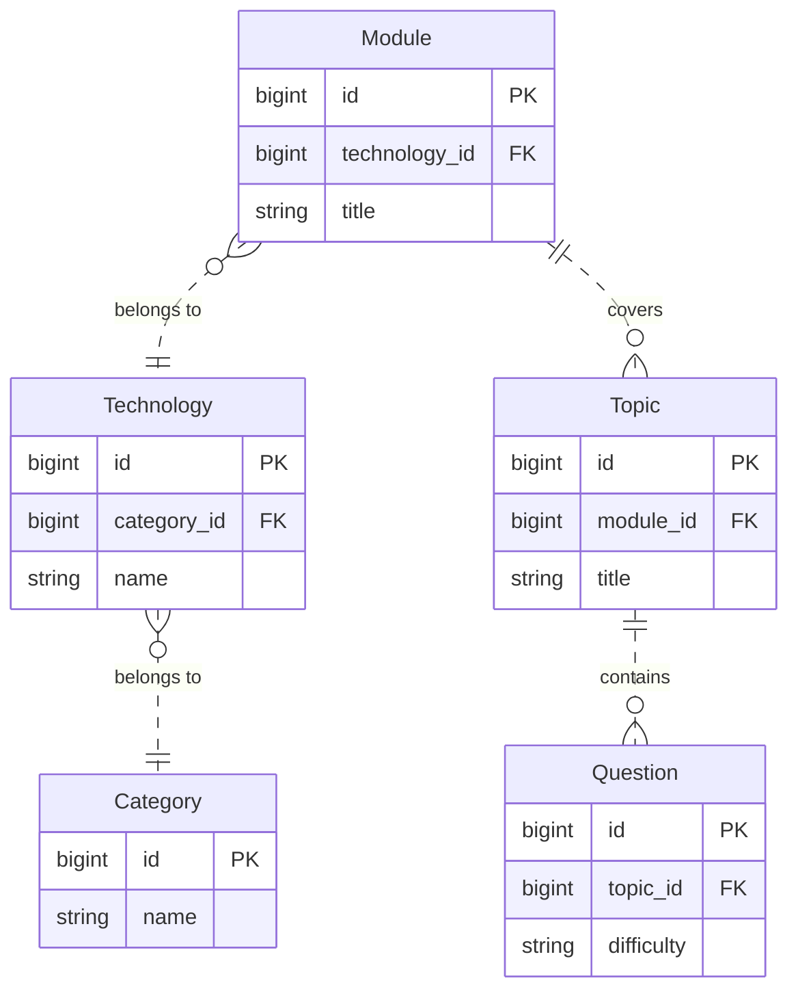
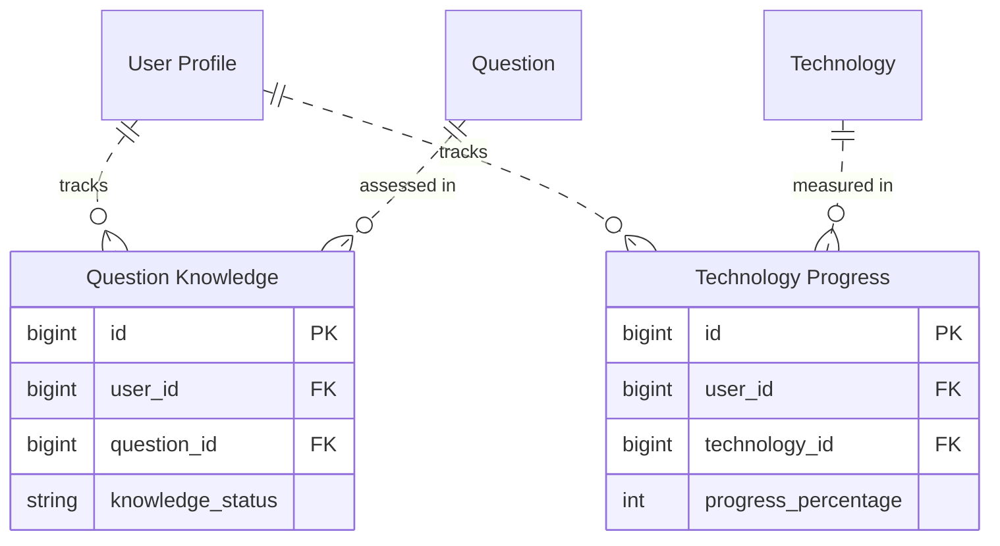

# Job Me

A career-preparation website created by The Gig Getters for the Code Institute October 2024 hackathon.

**Python · Django**

[Getting started](#getting-started) · [Data model](#entity-relationship-diagrams) · [Repository guide](#repository-guide) · [Checks](#checks-and-review) · [Credits](#credits-and-reuse)

## What you can explore

- Interview questions organised by category.
- Interview-practice pages and career-preparation resources.
- Accounts, profile features and an administrative interface.

> **Project notes:** This repository is Sam’s fork of the team project. Deployment and third-party authentication/storage services require their own configuration.

## Entity relationship diagrams

### Interview question library

A category groups technologies. Each technology has modules, each module has topics, and each topic has interview questions. [Question library models](job_me/models.py)



### Practice progress

Question knowledge links a member profile to a question, with one status per profile and question pair. Technology progress links a member profile to a technology and stores a percentage. Both models call their profile reference `user`. [Practice models](job_me/models.py) · [Member profile](users/models.py)



## Getting started

Requires Git, Python, pip and a virtual environment. Dependency pins in older projects may need a compatible Python environment; this README does not upgrade them.

```bash
git clone https://github.com/SamOBrienOlinger/elevate_hackathon_2024-get-a-gig.git
cd elevate_hackathon_2024-get-a-gig
python3 -m venv .venv
source .venv/bin/activate
python -m pip install -r requirements.txt
```

On Windows, activate the environment with `.venv\Scripts\Activate.ps1` instead.

After resolving the project notes and configuring the local environment, use:

```bash
python manage.py check
python manage.py migrate
python manage.py runserver
```

Open [localhost:8000](http://localhost:8000). Stop the server with **Ctrl+C**. Use `python manage.py createsuperuser` in the same project directory if you need access to Django admin.

## Configuration

Settings are defined in [elevate_hackathon_2024/settings.py](elevate_hackathon_2024/settings.py). Set the values used by your chosen local configuration before running Django. A `.env` file is only read when the project explicitly loads it; most of these projects read the process environment or an optional `env.py`.

| Variable | Purpose |
| --- | --- |
| `SECRET_KEY` | Django signing key. Use a locally generated value and keep it out of Git. |

Use a disposable development database for migrations and tests. Keep service credentials and local configuration out of commits.

## Repository guide

| Path | Purpose |
| --- | --- |
| [requirements.txt](requirements.txt) | Python dependency versions |
| [manage.py](manage.py) | Django management commands |
| [elevate_hackathon_2024/settings.py](elevate_hackathon_2024/settings.py) | Django configuration |
| [templates/](templates/) | Server-rendered page templates |

## Checks and review

From the directory containing `manage.py`, run `python manage.py check` and `python manage.py test` after configuring an isolated development database. Inspect the test modules: scaffold `tests.py` files may contain no actual tests.

Generate fresh results from the revision you are working on; historical test reports describe earlier runs.

## Deployment

Hosting entry points are recorded in [Procfile](Procfile). Configure the runtime, database, allowed origins and static/media handling for the chosen host. Historical deployment records may describe services that are no longer available.

## Credits and reuse

Forked from [ShaAnder/elevate_hackathon_2024](https://github.com/ShaAnder/elevate_hackathon_2024). Original authorship and contributor credits remain with that project.

Design decisions, original feature notes, historical testing evidence and detailed acknowledgements remain available in the preserved project record:

- [README.md · original project record](https://github.com/SamOBrienOlinger/elevate_hackathon_2024-get-a-gig/blob/f3968143d455d3b2badf60bb0ffa905e68050f39/README.md)

Learning resources and starter material: [Code Institute](https://codeinstitute.net/).

No repository-level licence file is present in this snapshot. This README does not grant additional reuse permissions. Check with the relevant rights holders before reusing code, written content or assets.

## Support

Repository maintained in [Sam O’Brien-Olinger’s GitHub account](https://github.com/SamOBrienOlinger). Use the [repository’s pull requests](https://github.com/SamOBrienOlinger/elevate_hackathon_2024-get-a-gig/pulls) to propose a documented change, or follow the upstream project’s contribution process.

[Back to top](#job-me)
